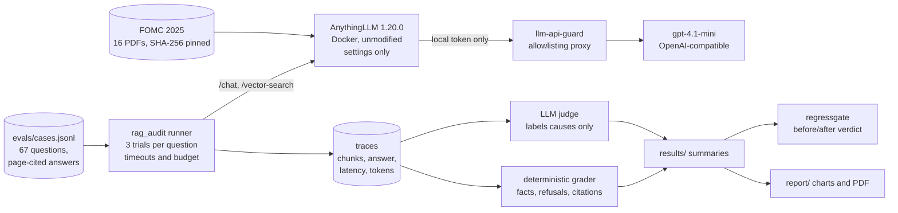

# rag-audit-sample

**Why does a RAG assistant give wrong answers, and which fix is worth making first?**

> **Sample audit on an open-source project (AnythingLLM 1.20.0, FOMC 2025 public-domain corpus).
> Not a client engagement.** It shows what a RAG/LLM answer audit delivers, run end to end on a
> well-known open-source RAG app, with every number reproducible from this repository.

The deliverable is a 5-page report, [`report/rag-audit-report.pdf`](report/rag-audit-report.pdf)
(source: [`report/rag-audit-report.md`](report/rag-audit-report.md)). This README is the case study.

| What was checked | Result | Evidence |
|---|---|---|
| Out-of-the-box answer quality, 67 questions × 3 trials | **44.8%** pass, correct and verifiable from the app's own citations | [`results/baseline/summary.json`](results/baseline/summary.json) |
| One settings change: the built-in local reranker | **62.7%** pass (+17.9 pp); 13 more questions pass in every trial | [`results/fix/summary.json`](results/fix/summary.json) |
| Is the gain beyond run-to-run noise? | regressgate **IMPROVEMENT**, p < 0.001 (10,000 shuffles). Per question: 15 up, 1 down, sign test p = 0.0003, bootstrap 95% CI +9.0 to +27.9 pp | [`results/compare-baseline-vs-fix.md`](results/compare-baseline-vs-fix.md) |
| Expected document in the top 4 chunks (what the model sees) | 0.562 → **0.842** with the reranker; 0.792 with a paid embedder swap | `results/*/summary.json` → `retrieval` |
| Main root cause | an expected document never retrieved: **81 of 201** baseline trials | `failures_primary` in the baseline summary |
| Cost of the whole audit | **≈$0.39** logged at list prices; timed-out calls unmetered | [docs/methodology.md](docs/methodology.md#the-judge-latency-cost-and-the-index) |

---

## The problem

A team ships a "chat with your documents" assistant. Users report confident wrong answers, but no
one can say how often, why, or which fix to try first. Here the assistant is AnythingLLM with its
default settings, over the 16 FOMC statements and minutes of 2025. The corpus is a hard, realistic
case: eight meetings in nearly identical language, numbers written as "4-1/4" or "4¼", and
questions that depend on dates.

## Setup



- **App:** AnythingLLM 1.20.0 (MIT), pinned by image digest, loopback only. Its code is never
  changed, so every fix is a setting a client can apply.
- **LLM access:** the app holds only a per-launch local token for `llm-api-guard`, the author's own
  local allowlisting proxy (not published here). It injects the real key of an OpenAI-compatible
  endpoint and blocks anything off the allowlist. `gpt-4.1-mini` is the configured model preference.
- **Grading:** deterministic checks decide pass or fail; the LLM judge only labels why a failed
  answer went wrong. See [docs/grader-design.md](docs/grader-design.md).

## Headline results

| Category | Questions | Baseline | Fix (rerank) |
|---|---|---|---|
| Fact | 16 | 25.0% | 47.9% |
| Numeric | 16 | 68.8% | 93.8% |
| Multi-hop | 11 | 0.0% | 18.2% |
| Statement vs minutes | 7 | 57.1% | 71.4% |
| Date-sensitive | 7 | 38.1% | 42.9% |
| Refusal | 10 | 83.3% | 93.3% |
| **All (mean per question)** | **67** | **44.8%** | **62.7%** |

The refusal gain comes from three baseline answers that declined and then invented content, for
example the contents of "January 2026 meeting minutes". Per-category rates are means over few
questions (7 to 16), so read them as directions.

Retrieval on the 56 answerable questions (`/vector-search` top 10, same 1000-character chunks):

| Configuration | Recall@1 | Recall@4 | Recall@10 | MRR@10 |
|---|---|---|---|---|
| Baseline, local MiniLM embedder | 0.315 | 0.562 | 0.938 | 0.513 |
| Embedder swap, text-embedding-3-small | 0.506 | 0.792 | 0.973 | 0.691 |
| **Fix, local reranker** | **0.583** | **0.842** | 0.964 | **0.773** |

## Top issues found

1. **Retrieval returns the wrong meeting's chunks** (81 of 201 baseline trials). Asked for the
   September 2025 range, the app retrieved July and October chunks and answered July's
   "4¼ to 4½ percent", 3 of 3 times.
2. **Confident answers about a meeting the context does not cover** (judge flag on 38 failed
   trials, indicative only). Asked who dissented in July, it named the March dissenter with his
   March reason.
3. **Right document, wrong chunk** (21 trials): the attendance chunk instead of the vote, so "no
   member dissented" when one did.
4. **Near-empty cover pages fill the context:** 99 of 804 context slots (12.3%), concentrated on date
   questions, which then get invented dates.
5. **The upload timestamp and "today" leak into answers:** "published on November 23, 2026" is the
   ingestion date the app writes into every chunk header, and some refusals invent 2026 content.

Trace excerpts (chunk ids, documents, scores) for each issue are in section 5 of the report.

## The fix

`vectorSearchMode: rerank`, one workspace setting. AnythingLLM's built-in local cross-encoder
re-scores the nearest chunks and keeps the top 4.

How it was chosen, in the order it happened:
1. After the baseline run, a 1-trial reranker pilot on the same 67 questions raised context recall@4
   to 0.84.
2. An embedder-swap probe reached 0.75. That probe also enlarged the chunks to about 6,000
   characters, so it changed two things at once.
3. The reranker was chosen on that comparison, and because it needs no re-ingest and no API spend
   and keeps the documents on the machine. It was then run with 3 trials.
4. After the fix run, the embedder was re-measured at the baseline's 1000-character chunks. It
   reached 0.79 against the reranker's 0.84, which confirms the choice.

Side effects, reported rather than hidden:
- the September minutes cover chunk, which holds only the upload timestamp, now ranks first for
  one date question, so that answer is wrong in 3 of 3 trials (2 of 3 passed before). At 3 trials
  a single-question drop cannot reach significance, so it is named rather than tested;
- 4 citation mismatches appear (right documents retrieved, but not the supporting passage), against
  none in the baseline;
- about 15% more prompt tokens, and slower retrieval because the reranker runs on CPU (median
  0.75 s against 0.27 s; end-to-end latency is indicative only, see the report).

The ranked fix plan (date-aware metadata, prompt changes, dropping cover pages at ingest, a larger
topN for multi-hop, a stronger judge) is section 7 of the report.

## Reproduce

From the committed traces, with no app and no LLM calls (Windows PowerShell; Python 3.11+):

```powershell
python -m venv .venv; .venv\Scripts\pip install -r requirements-dev.txt -r requirements-report.txt
.venv\Scripts\python -m rag_audit reproduce          # re-grade every configuration, re-run regressgate
.venv\Scripts\python -m pytest -q                    # 98 tests + 32 subtests
.venv\Scripts\python report\build-report-figures.py  # charts and derived numbers
.venv\Scripts\python report\render-report-pdf.py     # the PDF, via headless Microsoft Edge
```

A full live re-run needs Docker Desktop, the corpus and an OpenAI-compatible endpoint, ideally
behind your own allowlisting proxy. `llm-api-guard` is not published. To use your own proxy, point
`GENERIC_OPEN_AI_BASE_PATH` in `compose.yaml` at it; to use the guard, set `LLM_GUARD_DIR` to its
checkout. `--budget-usd` caps chat and judge calls together. Move `traces\` aside first, or saved
trials are skipped:

```powershell
python scripts\download-corpus.py          # 16 PDFs, fails on any SHA-256 mismatch
scripts\start-stack.ps1                    # proxy + app; first run creates an app API key in .run\
python scripts\anythingllm-client.py workspace --slug fomc-2025
python scripts\anythingllm-client.py ingest --slug fomc-2025 (Get-ChildItem data\corpus\*.pdf).FullName
.venv\Scripts\python -m rag_audit full-rerun --configs baseline fix --budget-usd 3
scripts\stop-stack.ps1
```

`python -m rag_audit --help` lists every step (`apply-config`, `retrieval`, `run`, `judge`, `pack`,
`report`, `compare`, `reembed`). The embedder candidate uses `scripts\start-stack.ps1 -Embedder
openai` followed by `python -m rag_audit reembed`.

| Path | What it is |
|---|---|
| `evals/cases.jsonl` | the eval set ([docs/eval-set-design.md](docs/eval-set-design.md)) |
| `rag_audit/` | runner, grader, judge and reports |
| `results/<config>/` | summary, per-trial grades, regressgate report, judge verdicts, packed traces |
| `report/` | report source, PDF, charts and their build scripts |
| `compose.yaml`, `compose.embedder-openai.yaml`, `scripts/` | the pinned app and the stack scripts |
| `docs/` | [methodology](docs/methodology.md), [eval-set design](docs/eval-set-design.md), [grader design](docs/grader-design.md) |

## Limitations

- **The fix was selected and measured on the same 67 questions; there is no held-out set.**
- One corpus, one chat model and 67 questions written by the auditor rather than taken from user
  logs. The numbers describe this setup, not AnythingLLM in general.
- 3 trials per question detect large changes; a drop on a single question cannot reach
  significance.
- The LLM judge agreed with manual labels on 11 of 18 trials (61%), below the 72% of always
  answering "unsupported", so unsupported-claim counts are indicative. Pass and fail never depend
  on it.
- The grader and the cases were refined after reading the baseline traces, in two rounds. Every
  change applies to both configurations, is listed by case id, and both were re-graded with
  `reproduce` ([details](docs/methodology.md#post-baseline-changes-to-the-grader-and-the-cases)).
- Latency is confounded by a provider slowdown during the fix run. Costs are estimates at OpenAI
  list prices.
- Only the reranker went through the full 3-trial run; the embedder swap was compared on retrieval.

## Licence and corpus attribution

Code: MIT ([LICENSE](LICENSE)). AnythingLLM is MIT-licensed by Mintplex Labs and is used unmodified.

The corpus is the 2025 FOMC post-meeting statements and minutes, publications of the Board of
Governors of the Federal Reserve System, which are in the public domain. **Source: Board of
Governors of the Federal Reserve System.** URLs and SHA-256 pins are in
[`corpus/corpus-manifest.json`](corpus/corpus-manifest.json); the PDFs are downloaded, not committed.
