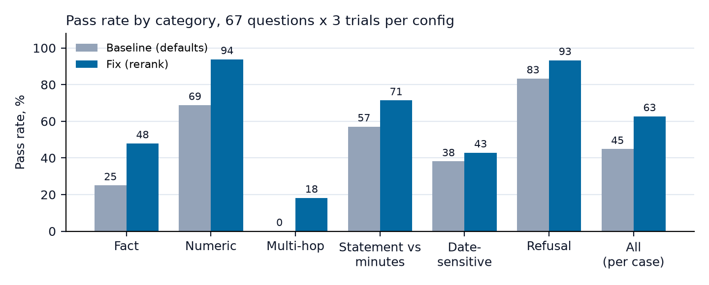
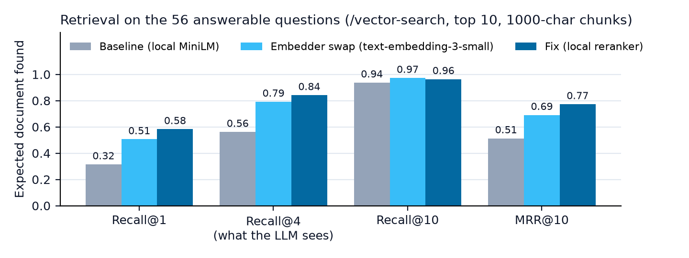
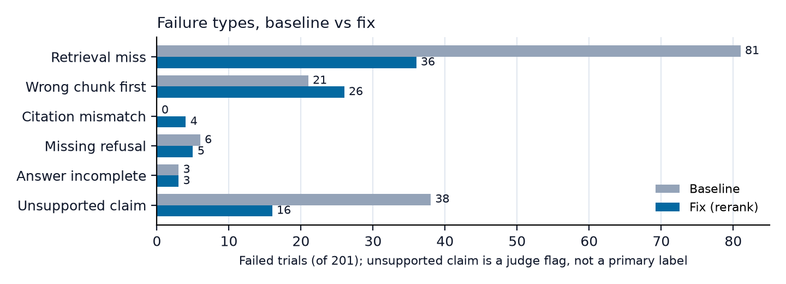

<div class="cover">
<p class="eyebrow">RAG answer audit · Standard package sample</p>
<h1>Why the FOMC assistant gives wrong answers, and the one setting that fixes about a third of them</h1>
<p class="label">Sample audit on an open-source project (AnythingLLM 1.20.0, FOMC 2025 public-domain corpus). Not a client engagement.</p>
<p class="meta">Report date 2026-11-23 · 67 test questions × 3 trials per configuration · every number reproducible from the repository</p>
</div>

## 1. Executive summary

**Out of the box, the assistant answered 44.8% of the test questions correctly and verifiably. Turning
on one built-in setting, the local reranker (`vectorSearchMode: rerank`), raised that to 62.7%
(+17.9 points).** The statistical gate (regressgate) rates the change an **IMPROVEMENT**: permutation
p < 0.001 (10,000 shuffles), which rules out run-to-run noise. Counted per question, 15 improved and
1 dropped (sign test p = 0.0003; bootstrap 95% CI of the gain +9.0 to +27.9 points).

- **Main root cause: retrieval, not the model.** In 81 of 201 baseline trials the expected document
  never reached the model. The question names a meeting ("September 2025"), but the default embedder
  ranks chunks from other meetings higher, and the model answers confidently from them.
- **What the fix does not solve:** date handling (42.9% pass), multi-hop questions (18.2%) and
  December questions that still pull earlier meetings. It also makes one known date bug systematic
  (section 6).
- **Recommended next steps (section 7):** put the meeting date into document metadata at upload,
  tighten the system prompt, drop cover pages at ingest, then raise topN to 6–8 for multi-hop.
  The first two are low effort and target most of the remaining failures.
- **Cost of the fix:** no re-ingest, no API spend, data stays on the machine; about 15% more prompt
  tokens. Retrieval becomes slower because the reranker runs on CPU (indicative numbers in section 6).

## 2. Scope and setup

| Item | Setting |
|---|---|
| Application | AnythingLLM 1.20.0 (MIT), Docker image pinned by digest, unmodified; only settings changed |
| Corpus | 16 PDFs, 181 pages: the 8 FOMC post-meeting statements and 8 sets of minutes of 2025. Source: Board of Governors of the Federal Reserve System (public domain) |
| Chat model | gpt-4.1-mini (the configured model preference) through an OpenAI-compatible endpoint, behind a local allowlisting proxy; streaming off, query mode per request, fresh session per question |
| Baseline | App defaults: local all-MiniLM-L6-v2 embedder, 1000-character chunks (20 overlap), topN 4, similarity threshold 0.25, default search, default system prompt |
| Out of scope | Agent and tool features, UI, multi-turn chat, security testing, load testing |

## 3. Method

**Eval set (67 questions, all with a page-cited source quote checked against the PDF text).**

| Category | Questions | What it probes |
|---|---|---|
| Fact | 16 | target ranges, dissenters, absent members, officers, next-meeting dates |
| Numeric | 16 | administered rates, balance-sheet caps, inflation and unemployment figures |
| Multi-hop | 11 | number of cuts in 2025, dissent histories, rate and cap paths across meetings |
| Statement vs minutes | 7 | facts that appear only in the minutes |
| Date-sensitive | 7 | release dates, "latest decision", "right now", next meeting in 2026 |
| Refusal | 10 | out-of-corpus questions: other central banks, 2026 data, a Powell successor |

**Grading is deterministic first.** An answer passes only if it states the key facts (numbers
compared by value after normalising "4-1/4", "4¼" and "4.25%"), contains no forbidden value, does not
decline in its lead, and the facts are also present in the chunks the app retrieved from the expected
document (for a multi-hop question, from every meeting it needs), so the answer is verifiable from
its own citations. A refusal question passes only if the first two sentences decline, none of the
invented specifics listed for that question appear, and the answer does not go on to guess. Each
failed trial gets one primary label: retrieval miss, wrong chunk first, citation mismatch, missing
refusal, answer incomplete or format/tool error.

**LLM judge, used narrowly.** gpt-4.1-mini (temperature 0) adds an "unsupported claim" flag to failed
answers. It never decides pass or fail. On a manual spot check of 18 baseline trials it agreed on
**11 of 18 (61%)**, below the 72% that always answering "unsupported" would score. The check is
in-sample, so the flag counts are indicative at best.

**Trials and gate.** Every question runs 3 times per configuration (201 trials each). regressgate
compares configurations with a permutation test on the pass rate and per-question Fisher exact tests
(Tarone-corrected). A sign test and a seeded bootstrap count each question once. Latency is reported
separately from quality. A timed-out call is retried (at most 2 billed calls per pass), and trials
still timed out got one explicit extra pass, so a few trials made up to 4 billed calls. Every attempt
stays in the trace.

**Disclosure.** The grader and the case file were refined after reading the baseline traces, in two
rounds. The second round followed a pre-release review: multi-hop support from every meeting,
refusals that decline and then invent content, list markers, and phrase terms instead of bare numbers.
Every change applies to both configurations and is listed by case id in `docs/methodology.md`. Both
were re-graded from the saved traces with `python -m rag_audit reproduce`. Round 2 moved the baseline
from 46.3% to 44.8% (three refusals that invented content) and left the fix at 62.7%.

## 4. Baseline results



| Category | Baseline pass rate | Main failure |
|---|---|---|
| Fact | 25.0% | wrong meeting retrieved |
| Numeric | 68.8% | wrong meeting retrieved |
| Multi-hop | 0.0% | only 4 chunks, cannot cover several meetings |
| Statement vs minutes | 57.1% | right document, wrong chunk |
| Date-sensitive | 38.1% | cover pages and ingestion date in context |
| Refusal | 83.3% | 2026 projections and "2026 minutes" content invented |
| **All (mean per question)** | **44.8%** | 28 questions always pass, 36 always fail, 3 flaky |

Retrieval explains most of it: the expected document was the top chunk for 31.5% of answerable
questions and in the top 4 (what the model sees) for 56.2%, but in the top 10 for 93.8%. The right
material is in the index; the ranking does not put it in front of the model.

## 5. Top 5 issues

Evidence is from the baseline traces: chunk id prefix, document, similarity score.

**1. Retrieval returns the wrong meeting's chunks** (primary failure in 81 of 201 trials).
*Evidence:* `fact-sep-range` asks for the range set in September 2025. Top 4: `0b44f67d` minutes-0730
0.751, `374acb0b` minutes-1029 0.741, `b924ed11` minutes-1029 0.733, `27d3f62f` statement-0507 0.728.
Answer: "…4¼ to 4½ percent at its September 2025 meeting", July's range, in 3 of 3 trials.
*Root cause:* a small general-purpose embedder sees nearly identical policy language in every
meeting; the month in the question barely moves the score. *Impact:* wrong numbers delivered with
full confidence on the most common question type.

**2. Confident answers about a meeting the context does not cover** (judge flag on 38 failed trials;
indicative, see section 3).
*Evidence:* `fact-jul-dissenters` retrieved only the May, June, March and October statements; the
answer named Waller as the sole July dissenter, with the reason he gave in March, in 3 of 3 trials
(correct: Bowman and Waller, both for a ¼-point cut). *Root cause:* the default prompt does not ask
the model to check that the context matches the meeting asked about, or to say so when it does not.
*Impact:* errors are plausible and hard for users to spot.

**3. Right document, wrong chunk** (21 trials). *Evidence:* `fact-mar-dissent` retrieved the March
minutes, but the attendance and notation-vote chunk (`3e780687`, 0.567), not the vote. Answer: "No
member dissented", in 3 of 3 trials; Waller did dissent. *Root cause:* 1000-character chunks split
the vote record from its context, and similarity ranks the boilerplate higher. *Impact:* false
negatives that look authoritative.

**4. Near-empty cover pages fill the context.** 99 of 804 context slots (12.3%) are chunks with under
150 characters of content, in 45 of 201 trials, concentrated on date questions. *Evidence:*
`date-jan-statement-release` received four minutes cover pages (`7db2ce0a`, `9a915ea1`, `7b8733fe`,
`d340d86d`, 0.624–0.635) and answered "January 31, 2025" (actual: January 29). *Root cause:* a cover
page is little more than a date, so it is embedded close to any date question. *Impact:* the model
sees no evidence and fills the gap with an invented date.

**5. The ingestion date and "today" leak into answers.** *Evidence:* `date-sep-minutes-published`
answered "published on November 23, 2026", the upload timestamp the app writes into every chunk
header. `date-current-range` answered "4¼ to 4½ percent" for the current range (the December 2025
range is 3½–3¾), with no caveat, 3 of 3. `ref-sep-2026-dots` invented a June 2026 projection in 2 of
3 trials; `ref-jan-2026-decision#3` declined, but only after describing "January 2026 meeting
minutes". *Root cause:* the chunk header's `published:` field and the prompt's injected current date
look like document facts to the model. *Impact:* wrong dates, stale "current" answers and invented
2026 content.

## 6. The fix applied: local reranker

**How the fix was chosen, in the order it happened.**

1. After the baseline run, the reranker was piloted with 1 trial on the same 67 questions. Context
   doc recall@4 rose to 0.84 (baseline 0.56).
2. An embedder swap, probed next, reached 0.75. That probe also enlarged the chunks to about 6,000
   characters, because the app uses the embedder's maximum length as the chunk size, so it changed
   two things at once.
3. The reranker was chosen on that comparison: higher recall at the same topN and prompt size, no
   re-ingest, no API spend, and the data stays on the machine. It was then run with 3 trials.
4. After the fix run, the embedder was re-measured at the baseline's 1000-character chunks. It
   reached 0.79, which confirms the choice.

The fair comparison, all on the same chunks and the same `/vector-search` top-10 probe over the 56
answerable questions:

| Configuration | Recall@1 | Recall@4 | Recall@10 | MRR@10 | Re-ingest | API spend | Data leaves machine |
|---|---|---|---|---|---|---|---|
| Baseline, local MiniLM | 0.315 | 0.562 | 0.938 | 0.513 | | | |
| Embedder swap, text-embedding-3-small (measured after the fix run) | 0.506 | 0.792 | **0.973** | 0.691 | yes | per query and per document | yes |
| **Local reranker (chosen)** | **0.583** | **0.842** | 0.964 | **0.773** | no | none | no |



The reranker puts the right document in front of the model more often (recall@4 0.842 against
0.792). The embedder is ahead only in the top 10. Raising topN to 10 also reaches 0.938 recall, but
sends 2.5 times the context. The fix was selected and measured on the same 67 questions
(section 8).

**Before and after (3 trials × 67 questions each).**

| Metric | Baseline | Fix | Change |
|---|---|---|---|
| Pass rate (mean per question) | 44.8% | **62.7%** | **+17.9 pp** |
| Fact / numeric / multi-hop | 25.0 / 68.8 / 0.0% | 47.9 / 93.8 / 18.2% | +22.9 / +25.0 / +18.2 pp |
| Statement vs minutes / date / refusal | 57.1 / 38.1 / 83.3% | 71.4 / 42.9 / 93.3% | +14.3 / +4.8 / +10.0 pp |
| Questions always pass / always fail | 28 / 36 | 41 / 24 | +13 / −12 |
| Retrieval miss / wrong chunk (primary) | 81 / 21 | 36 / 26 | −45 / +5 |
| Cover-page chunks in context | 12.3% of slots | 2.2% | |
| Prompt tokens, 201 trials | 182,991 | 210,981 | +15% |



**regressgate verdict: IMPROVEMENT.** 44.8% → 62.7% over 67 shared questions. The permutation test
gives p < 0.001 for a gain (10,000 shuffles) and 1.0 for a drop. It rules out run-to-run noise on
these questions, not on other questions.

- **Per question:** 15 improved, 1 dropped and 51 were unchanged. The one-sided sign test gives
  p = 0.0003. A bootstrap over the 67 questions gives a 95% CI for the gain of +9.0 to +27.9 points.
- **The refusal gain (+10 points)** comes from three baseline answers that declined and then
  invented content. The fix's answers to those questions did not.
- **The one drop is `date-sep-minutes-published`** (2/3 → 0/3). At 3 trials per question no single
  drop can reach significance, so it is named here rather than tested. Its cause is clear: the
  reranker scores the September minutes cover chunk, which carries only the upload timestamp, at
  the top. All three answers say "published on November 23, 2026, at 6:36:32 AM", so issue 5
  became systematic for this question.
- **Citation mismatches** (right answer, every expected document retrieved, but not the supporting
  passage) went from 0 to 4: `fact-soma-manager` ×2 and `mh-upper-bound-jul-oct` ×2.
- **The judge's unsupported-claim flag** fell from 38 to 16 failed trials. The judge scores below a
  constant "unsupported" answer on its spot check (61% against 72%, in-sample, baseline only), so
  read this as a hint, not a measurement.

**Latency (indicative only).** Retrieval plus reranking took a median 0.75 s against 0.27 s (p90
2.65 s against 0.52 s), because the reranker runs on CPU. End-to-end p95 rose from 2.87 s to 42.51 s.
That tail comes from the provider, which stalled during the fix run: LLM time reached 56.5 s while
its median stayed at 1.5 s in both runs. Re-measure in a quiet window before deciding on latency.

## 7. Fix plan, ranked by impact and effort

| # | Action | Fixes | Impact | Effort |
|---|---|---|---|---|
| 1 | **Date-aware metadata.** Name each upload with its meeting date ("FOMC minutes, 2025-09-17") and filter or boost by the month named in the question | Issues 1, 2; remaining December confusion (e.g. `fact-dec-range` still answers October's 3¾–4) | High | Low–medium |
| 2 | **Prompt change.** Answer only from context; name the meeting behind each fact; decline when the context lacks the meeting asked about; state that the current date is not a document date | Issues 2, 5; the 5 missing refusals | High | Low |
| 3 | **Drop cover pages at ingest** and keep the upload timestamp out of model-visible chunk text | Issues 4, 5; the reranker's systematic ingestion-date answer | Medium | Medium |
| 4 | **Raise topN to 6–8 with rerank** for cross-meeting questions | Multi-hop (18.2%) | Medium | Low (≈1.6× prompt tokens) |
| 5 | **Stronger judge.** Re-run the spot check with a stronger model or a second human label; adopt it only above 80% agreement | Confidence in the unsupported-claim counts | Medium (audit quality) | Low |
| 6 | **Embedder swap on top of rerank**, if documents may leave the machine | Recall@10 0.973 suggests some extra headroom | Low–medium | Medium (re-ingest) |

Re-run the same eval set after each change and keep regressgate in CI, so a later prompt or model
change cannot silently undo the gains.

## 8. Limitations

- One corpus, one chat model and 67 questions written by the auditor, not from real user logs.
  The figures describe this setup, not AnythingLLM in general.
- **The fix was selected and measured on the same 67 questions; there is no held-out set.** The
  gain is in-sample.
- 3 trials per question detect large changes. A drop on a single question cannot reach
  significance.
- The judge agreed with manual labels on 11 of 18 cases (61%), below a constant "unsupported"
  answer (72%), so unsupported-claim counts are indicative. Pass and fail never depend on it.
- The grader was refined after reading baseline traces (section 3). Both configurations were
  re-graded with the same final grader.
- Latency is confounded by provider load during the fix run.
- Costs use OpenAI list prices; the provider's own price was not verified. **About $0.39 is logged**
  in `results/` for the whole audit. Timed-out calls (117 attempts) and embedding calls are not
  metered.
- Only the reranker went through the full 3-trial run; the embedder swap was compared on retrieval.

## Appendix: how to reproduce

Every number in this report is recomputed from the committed traces, with no app and no LLM calls:

```
python -m venv .venv; .venv\Scripts\pip install -r requirements-dev.txt -r requirements-report.txt
.venv\Scripts\python -m rag_audit reproduce          # re-grade every configuration, re-run the gate
.venv\Scripts\python report\build-report-figures.py  # charts and derived numbers
.venv\Scripts\python report\render-report-pdf.py     # this PDF (Microsoft Edge, headless)
```

A full live re-run needs Docker Desktop and an OpenAI-compatible endpoint, ideally behind your own
allowlisting proxy. It is `python -m rag_audit full-rerun --configs baseline fix --budget-usd 3`,
and the budget covers the judge calls too. Configurations are in `rag_audit/audit_configs.py`, raw
results in `results/`.
